# Snapia

**Toma la foto. La IA hace el resto.** Un proyecto de Smart Wash.

Snapia es una app de fotos instantáneas con inteligencia artificial. Tomas fotos rápidas ("snaps") del tablero, de una obra o de un producto y las guardas en **Espacios**. La IA analiza cada foto en segundo plano y, según el modo del Espacio, la convierte en trabajo terminado:

- **Estudio**: lee el tablero, saca el texto y los conceptos clave, y arma apuntes, resúmenes, guías para trabajos, flashcards, quizzes y un chat que responde citando tus fotos.
- **Trabajo**: describe lo que se hizo, el avance y los problemas visibles, y arma informes diarios y de avance con fotos como evidencia.
- **Contenido**: califica la foto, sugiere cómo mejorarla y escribe el caption, los hashtags y el texto alternativo para publicar.

Encima hay una capa social: Instantes que duran 24 horas, posts, feed, likes, comentarios, Explorar por hashtag y perfiles públicos. Y una app para **reloj Wear OS** con la que repasas sin sacar el celular.

| Carpeta                                        | Qué es                                             |
| ---------------------------------------------- | -------------------------------------------------- |
| [`apps/web`](apps/web/README.md)               | La app: PWA en React para celular y computador     |
| [`apps/api`](apps/api/README.md)               | La API: Express, PostgreSQL, fotos e IA            |
| [`apps/wear`](apps/wear/README.md)             | La app del reloj (Wear OS, Android Studio)         |
| [`packages/shared`](packages/shared/README.md) | Esquemas y tipos que comparten la API y la web     |
| [`docs`](docs)                                 | Producto, API, arquitectura, decisiones y capturas |

## Capturas

En el celular (web), con datos de ejemplo de dos personas ficticias, a 390×844:

<table>
  <tr>
    <td align="center">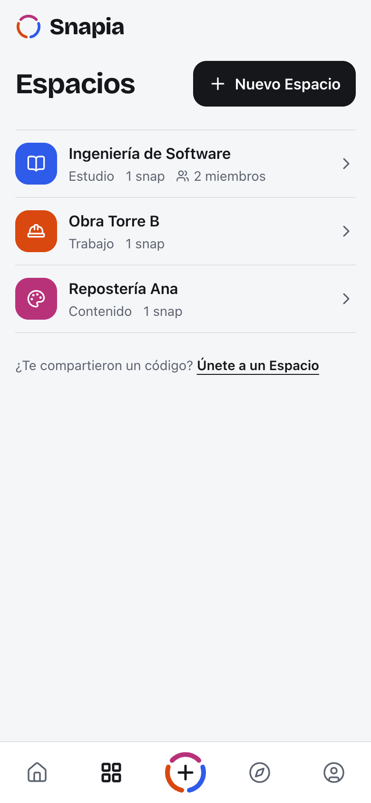<br>Espacios</td>
    <td align="center">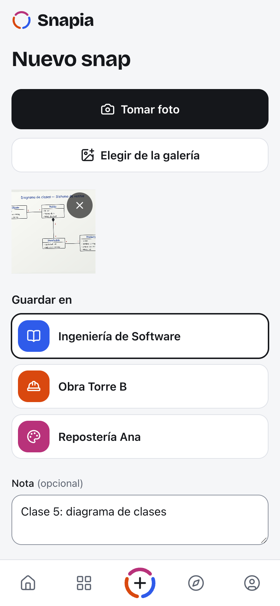<br>Cámara</td>
    <td align="center">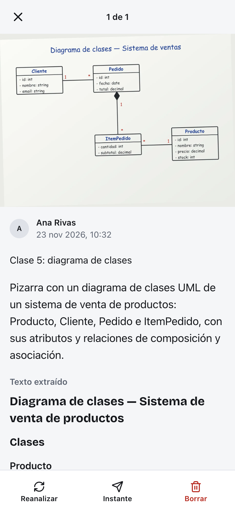<br>Análisis de la IA</td>
  </tr>
  <tr>
    <td align="center">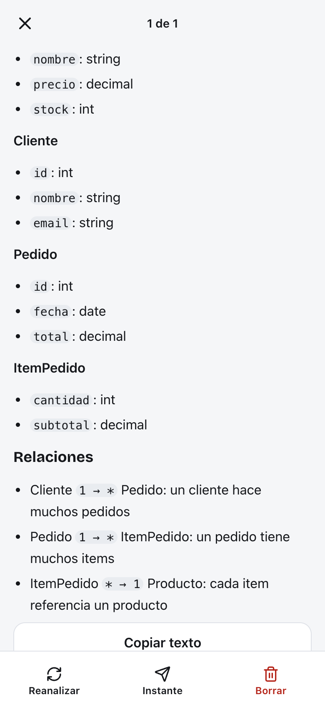<br>Texto extraído</td>
    <td align="center">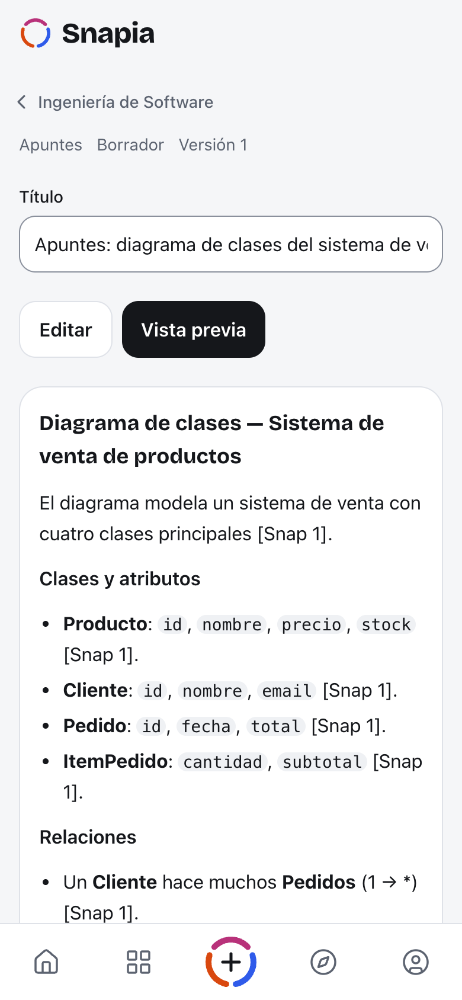<br>Apuntes con IA</td>
    <td align="center">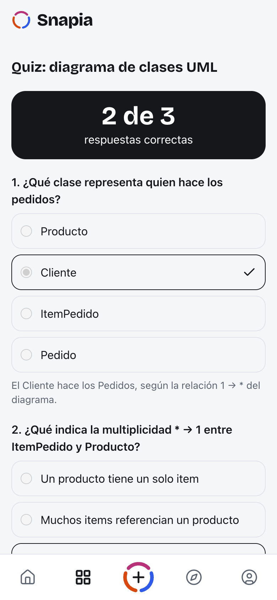<br>Quiz</td>
  </tr>
  <tr>
    <td align="center">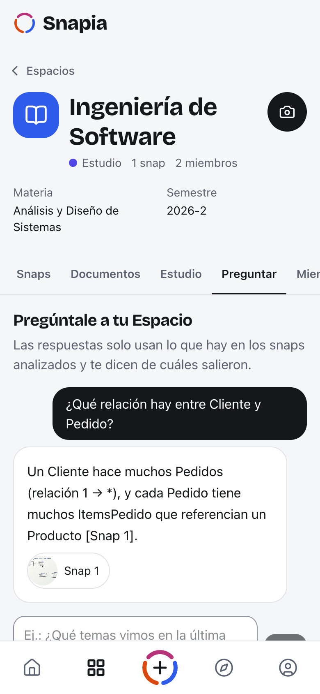<br>Pregúntale a tu Espacio</td>
    <td align="center">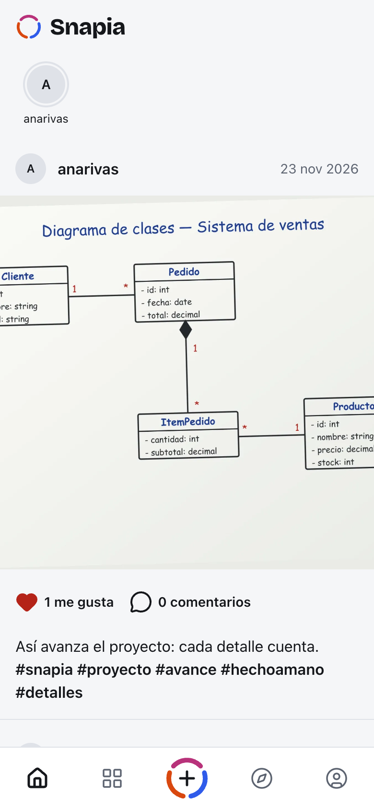<br>Inicio</td>
    <td align="center">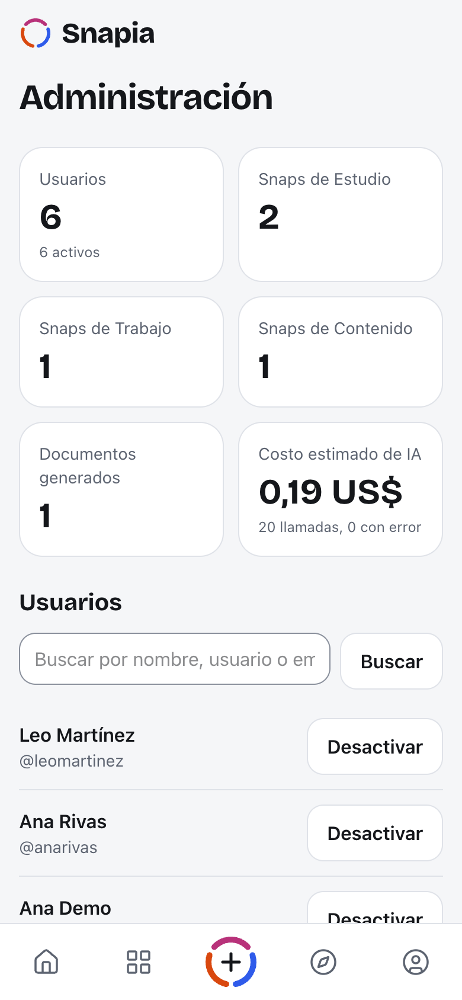<br>Administración</td>
  </tr>
</table>

En el reloj (Wear OS):

<table>
  <tr>
    <td align="center">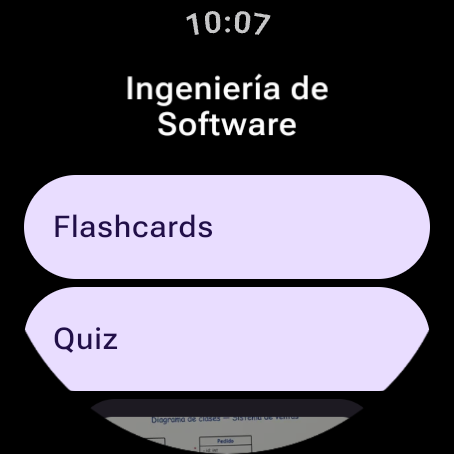<br>Espacio</td>
    <td align="center">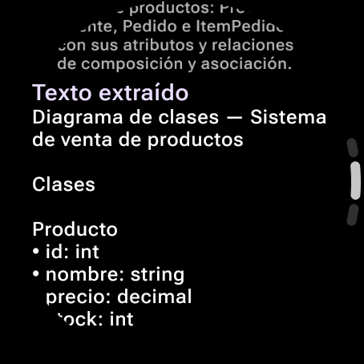<br>Análisis</td>
    <td align="center">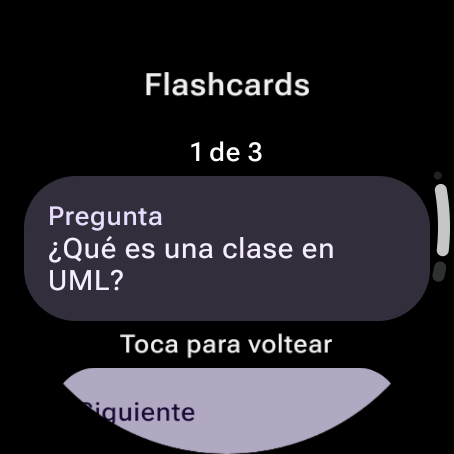<br>Flashcard</td>
  </tr>
  <tr>
    <td align="center">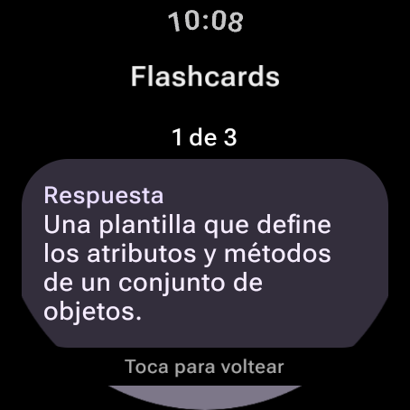<br>Respuesta</td>
    <td align="center">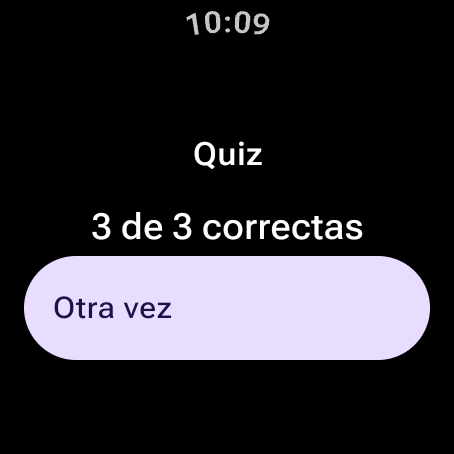<br>Quiz</td>
    <td align="center">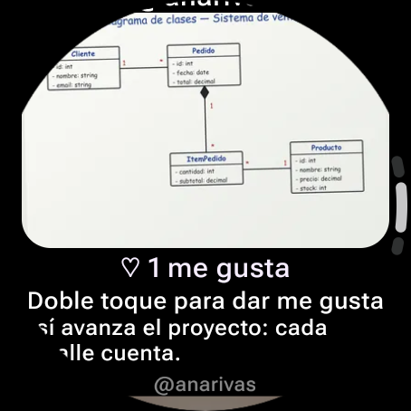<br>Inicio</td>
  </tr>
</table>

En el computador:

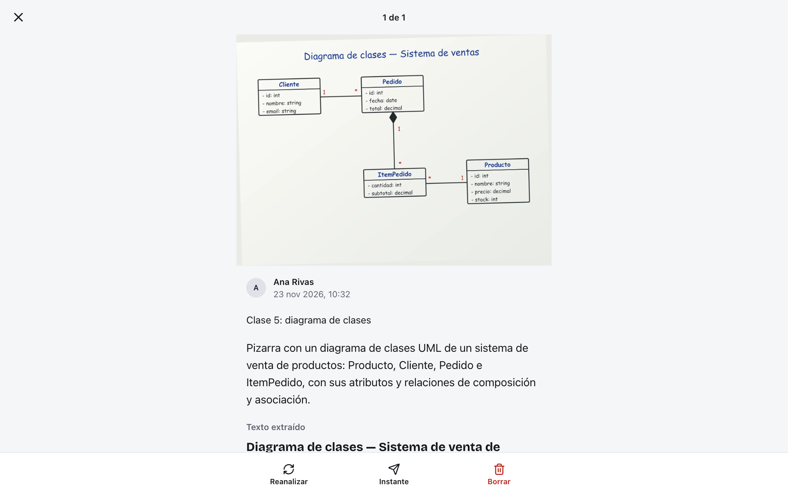

Todas las capturas, en orden de uso: [docs/capturas](docs/capturas/README.md).

## Tecnologías

**Web**

| Pieza                  | Uso                                        |
| ---------------------- | ------------------------------------------ |
| React 19 + TypeScript  | Interfaz                                   |
| Vite + vite-plugin-pwa | Desarrollo, build y app instalable         |
| TanStack Query         | Datos de la API y refresco del análisis    |
| Tailwind CSS 4         | Estilos con tokens propios, claro y oscuro |
| i18next                | Todos los textos en español                |

**API**

| Pieza                  | Uso                                                         |
| ---------------------- | ----------------------------------------------------------- |
| Node.js 22 + Express 5 | Servidor                                                    |
| Prisma + PostgreSQL    | Base de datos                                               |
| MinIO / S3 + sharp     | Fotos sin metadatos, en WebP, con URLs firmadas             |
| Claude (Anthropic)     | Visión e IA, con un modo de prueba sin costo                |
| Zod                    | Validación de entradas, configuración y respuestas de la IA |

**Reloj**

| Pieza                         | Uso                          |
| ----------------------------- | ---------------------------- |
| Kotlin + Compose para Wear OS | Pantallas redondas del reloj |

## Estructura

```
smart-watch/
├── apps/
│   ├── api/              API REST (Express + Prisma)            → apps/api/README.md
│   ├── web/              App web / PWA (React)                  → apps/web/README.md
│   └── wear/             App del reloj (Wear OS)                → apps/wear/README.md
├── packages/
│   └── shared/           Esquemas Zod y tipos compartidos       → packages/shared/README.md
├── docs/
│   ├── PRODUCT.md        Producto: glosario, modos y reglas
│   ├── api.md            Todos los endpoints
│   ├── arquitectura.md   Cómo se conectan las piezas
│   ├── decisiones.md     Decisiones técnicas y por qué
│   ├── HANDOFF.md        Estado del proyecto y lo que falta
│   └── capturas/         Imágenes de la app
├── .github/workflows/    CI: instala, revisa tipos y compila
├── docker-compose.yml    PostgreSQL y MinIO para desarrollo
├── .env.example          Todas las variables, explicadas
└── CLAUDE.md             Reglas del proyecto (capas, idioma, nada quemado, commits)
```

## Cómo ejecutarlo

### Requisitos

- Node.js 22 (`nvm use`) y npm
- Docker Desktop
- Android Studio, solo para el reloj

### 1. Configurar

```bash
cp .env.example .env
npm install
```

Los valores del ejemplo sirven tal cual para correrlo en tu computador. La IA viene en modo de prueba (`AI_PROVIDER=mock`): responde con un ejemplo fijo, sin costo. Para usar Claude de verdad, pon `AI_PROVIDER=anthropic` y tu `ANTHROPIC_API_KEY`.

### 2. Levantar la base de datos con datos de prueba

```bash
npm run db:up
npm run db:migrate
npm run db:seed
```

### 3. Encender la API y la web

```bash
npm run dev
```

Abre `http://localhost:5173`.

### 4. Ingresar

| Cuenta        | Usuario    | Contraseña                               |
| ------------- | ---------- | ---------------------------------------- |
| Estudiante    | `ana.demo` | `demo-password-ana`                      |
| Su compañero  | `leo.demo` | `demo-password-leo`                      |
| Administrador | `admin`    | la de `SEED_ADMIN_PASSWORD` en tu `.env` |

### 5. En el celular

```bash
npm run dev:web -- --host
```

Abre en el celular, en el mismo Wi-Fi, la dirección **Network** que muestra la terminal. Para que también carguen las fotos, en el `.env` pon `MINIO_BIND_ADDRESS=0.0.0.0` y `S3_ENDPOINT=http://<IP-de-tu-computador>:9000`, y reinicia con `npm run db:down && npm run db:up`.

### 6. En el reloj

Crea un reloj virtual **Wear OS Large Round** en Android Studio, conéctalo con `adb reverse` y abre `apps/wear`. Los pasos completos están en [apps/wear/README.md](apps/wear/README.md).

## API

Todos los endpoints, con su permiso, cuerpo, respuesta y errores, están en [docs/api.md](docs/api.md). Las respuestas siempre son `{ data, meta }` y los errores `{ error: { code, message, details } }`.

| Grupo                  | Ejemplos                                                                                                                      |
| ---------------------- | ----------------------------------------------------------------------------------------------------------------------------- |
| Cuenta                 | `POST /api/auth/login`, `GET /api/auth/me`                                                                                    |
| Espacios               | `POST /api/spaces`, `POST /api/spaces/:id/invites`, `POST /api/spaces/join`                                                   |
| Snaps e IA             | `POST /api/spaces/:id/snaps`, `GET /api/snaps/:id/insight`, `GET /api/spaces/:id/analysis-status`                             |
| Crear con IA y estudio | `POST /api/spaces/:id/documents`, `GET /api/documents/:id/export`, `POST /api/spaces/:id/quizzes`, `POST /api/spaces/:id/ask` |
| Social                 | `GET /api/feed`, `POST /api/posts`, `POST /api/moments`, `GET /api/explore`                                                   |
| Administración         | `GET /api/admin/stats`, `PATCH /api/admin/settings/:key`                                                                      |

## Decisiones de diseño

Las doce decisiones, con su porqué, están en [docs/decisiones.md](docs/decisiones.md). Las principales:

1. **Capturar primero.** Subir una foto nunca espera a la IA: el análisis corre en segundo plano y la app se actualiza sola.
2. **La IA sugiere, la persona decide.** Todo lo que escribe la IA es un borrador editable, y cita las fotos que usó.
3. **Privado por defecto.** Las fotos pierden su GPS al subir, y solo quien puede verlas recibe un enlace que vence.
4. **Nada quemado en el código.** Lo que cambia por ambiente va en `.env`; las reglas del producto se editan en el panel de administración.
5. **La IA detrás de una interfaz.** Claude o un modo de prueba, con la misma validación y el mismo registro de costos.

## Pruebas

```bash
npm run db:up
npm run lint && npm run typecheck && npm test && npm run build
```

310 pruebas de la API (con su propia base de datos), 4 de la web y 17 de los esquemas compartidos. El CI de GitHub instala, revisa tipos y compila en cada push.

## Pendientes

1. Editar el análisis de la IA y la nota de un snap desde la web.
2. Ajustes del Espacio (editar, archivar) y manejo de miembros (cambiar rol, sacar, salir).
3. Editar el perfil y la foto de perfil; listas de seguidores.
4. Moderación (ocultar posts y comentarios) y panel de uso de IA por tarea y por persona.
5. Conectar el reloj sin escribir usuario y contraseña (código de 6 dígitos).

El detalle está en [docs/HANDOFF.md](docs/HANDOFF.md).

## Autor

Hecho por [brash777](https://github.com/brash777) para el proyecto Smart Wash.
